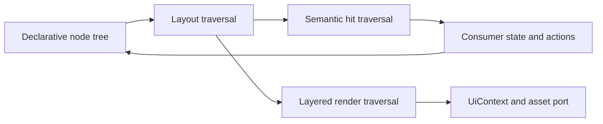

# Requirements

### Overview & Goals
Evaluate how to make `@hoard-engine/uikit` more portable without a broad rewrite. The generic composition DSL and its `Welcome` pilot are complete; now reimplement the ten identified game-shaped components with that DSL in the game repository, remove those components from UIKit, and verify consumer parity.

### Scope
- **In scope:** The completed reuse inventory, composition DSL, and `Welcome` pilot; add reusable data-only composition capabilities for exact screen visuals/hits; then port `heroCards`, `heroStatus`, `monsterCards`, `dungeonIntro`, `saveLoadDialog`, `newGameDialog`, `heroSelection`, `eventCard`, `diary`, and `betweenDungeons` into consumer-owned composition trees; remove their UIKit source modules and public exports; preserve consumer-owned state, adapters, strings, assets, and rendering parity.
- **Out of scope:** Moving generic widgets or the composition DSL out of UIKit; adding game/framework dependencies to UIKit; changing pinned snapshots beyond the screen migrations explicitly approved by the user.

### Acceptance Criteria
- Existing generic `layout`/`hitTest`/`render` contracts, semantic hits, theme tokens, translator/assets ports, and public exports remain compatible; only the ten named screen exports are removed.
- DSL state and action handling remain consumer-owned; the DSL communicates actions through data/semantic identifiers.
- An optional image replaces the corresponding canvas-drawn visual when available; missing images use a themed fallback without changing geometry or hit areas.
- The DSL's usefulness is supported by consumer usage and `Welcome` parity evidence; this migration follows the user's decision to keep the ten game-shaped screens in the game repository.
- The ten listed game-shaped renderers are implemented in the game repository using the public composition DSL, and are no longer part of UIKit's source or public surface.
- Consumer semantic hits and required interactions remain compatible; reviewed visual differences from the composition migration are approved and captured in the consumer snapshots.
- The DSL can express the mapped visual and semantic-hit requirements through plain nodes and data, without arbitrary consumer render callbacks or game-domain imports.

# Technical Design

### Current Implementation
- `src/index.ts` is the package's single source export surface, re-exporting primitives, `src/env.ts`, five `src/kit/` widgets, and 14 components. `package.json` exposes the root and `./testing` only; the build bundles the root and testing entries.
- Components follow pure layout, semantic hit-test, and `UiContext` render functions. `src/components/menu.ts` is a compact example with plain view-model data and item-id hits; `src/components/welcome.ts` demonstrates layered background/panel/control/footer drawing and a background asset override.
- `src/env.ts` defines the theme, translator, text measure, asset provider, and canvas context contracts. `src/kit/spriteFrame.ts` resolves image assets and returns `false` when unavailable so callers can draw their fallback.
- `README.md` catalogs component APIs and describes the three-function contract. `src/components/independence.test.ts`, `src/testing/recordingContext.ts`, `src/testing/sentinelTheme.ts`, and `src/publicSurface.test.ts` provide suitable validation patterns.
- The game consumer is not included in this checkout. Its adapters and renderer parity snapshots must be consulted in the originating game repository; this plan uses `Welcome` as the agreed pilot.

### Key Decisions
- **Use a recursive interpreter for the DSL:** A plain node tree is consumed by shared layout, hit-test, and render traversals. This matches the package's data-only view-model approach and centralizes content layering.
- **Keep the DSL in UIKit; move screen compositions to the consumer:** The completed evaluation added the module to `src/components/` and its public surface. The current migration ports screen trees to the game repository and removes only the named game-shaped renderers from UIKit.
- **Keep rendering and behavior consumer-driven:** Use theme tokens and existing `UiContext` ports; leave state/action handling with the consumer and preserve existing renderers during the pilot.

### Proposed Changes
The opt-in composition module and `Welcome` proof are complete. Extend the generic DSL only for concrete reusable gaps found while mapping the ten screens: full-bounds fills/scrims, divider/line drawing, text decoration, arbitrary positioned children, hit-only interactive regions, and image fallback layering for sprite/icon visuals. Keep these capabilities data-only and typed to theme tokens; compose the screens in the consumer, then remove their UIKit-specific implementations and exports after consumer parity is verified.

### Architecture Diagram

### Risks
- A DSL that recreates existing component APIs could become a second UI framework; keep it opt-in and limited to the specified generic primitives, and use the `Welcome` pilot to test practical reuse.
- The game consumer and its parity snapshots are external to this checkout; inspect existing coverage and compare each migrated renderer in the originating repository before removing its UIKit implementation.
- Existing renderers may rely on detailed text wrapping, clipping, sprite handling, or game-specific visual treatments that the current DSL does not express; map these gaps during the consumer inventory and extend the generic DSL only where needed, without embedding game concepts.
- The first migration attempt confirmed that scrims, dividers, strikethrough, arbitrary placements, hit-only nodes, and conditional sprite-to-icon fallback are necessary. The user approved snapshot updates for reviewed composition differences; keep extensions generic and bounded so the DSL does not become an escape hatch for arbitrary canvas rendering.
- The requested migration changes UIKit's public export surface. Remove only the ten named game-shaped components, keep generic widgets and existing composition exports, and update the public-surface and independence tests accordingly.

# Testing

### Validation Approach
- Add colocated tests for DSL layout, semantic hit mapping, layered rendering, image override selection, and themed fallback when an image is unavailable.
- Use the existing recording context and sentinel theme to verify deterministic, theme-driven drawing; keep the boundary and public-surface tests green.
- Retain the completed DSL-backed `Welcome` comparison; inspect each migrated screen's consumer snapshot diff, confirm geometry and semantic hits with facade tests, and update only reviewed snapshot entries before removing its UIKit renderer.
- Run the package checks specified by the repository: `npm run check`, `npm test`, `npm run lint`, and `npm run prettier`.

# Delivery Steps

### ✓ Step 1: Inventory consumer usage and establish the Welcome baseline
A consumer-use inventory identifies reusable UI and game-shaped screens, with the current `Welcome` rendering behavior recorded as the pilot baseline.

- Inspect component adapters and screen usage in the originating game repository, since it is not present in this UIKit checkout.
- Classify used components as generic reuse or game-concept-specific, and note overlaps and consumer dependencies.
- Record the classification and `Welcome` baseline alongside the evaluation notes in `TODO.md`; consult the consumer's parity snapshots before proposing renderer changes.

### ✓ Step 2: Add the recursive composition DSL and its contracts
`src/components/composition.ts` exposes an opt-in node-tree API with shared layout, hit-test, and layered render traversals.

- Define data-only nodes for rows, columns, spacers, text, buttons, checkboxes, text inputs, images, meters, and basic panels.
- Preserve stable layout geometry and semantic action identifiers; keep state and action handling with the consumer.
- Resolve optional image overrides through `UiContext.assets` and use themed drawing when an image is missing or unavailable.
- Re-export the module from `src/index.ts` and add colocated tests for layout, hits, rendering layers, image handling, and theme-driven fallback.

### ✓ Step 3: Validate the DSL with the consumer Welcome screen
A DSL-backed `Welcome` composition is validated against the real consumer adapter while the existing `renderWelcome` behavior remains unchanged.

- Map the consumer's existing `Welcome` view-model data into the composition tree without importing game-domain types into UIKit.
- Compare layout, semantic button hits, background-image override/fallback, and rendered output with the established consumer baseline.
- Add or update consumer-side visual parity coverage in the game repository; do not move or alter the existing renderer as part of the pilot.

### ✓ Step 4: Document initial package-boundary findings and adoption guidance
The completed evaluation documented the public entry points and initially recommended deferring extraction; that recommendation is superseded by the user's current decision to move the ten named screens to the game repository.

- Update `README.md` with the DSL's intended public usage and the distinction between generic composition and game-shaped screen components.
- Assess whether a separate optional package or subpath offers meaningful adoption choices versus release/versioning overhead.
- Preserve the then-current component exports during the evaluation; the approved migration is tracked in Steps 5–8 below.
- Run `npm run check`, `npm test`, `npm run lint`, and `npm run prettier` after the UIKit changes.

### ✓ Step 5: Map the ten component migrations and establish parity gates
The consumer render paths, adapters, dependency points, and existing parity coverage for all ten named components are identified before implementation begins.

- Inspect the corresponding consumer renderers, adapters, event/hit dispatch, tests, and pinned snapshots in `/Users/oscar/dev/hoard/drakriddarna`.
- Match each named UIKit component to its current consumer entry point and identify specialized rendering needs the composition DSL must support.
- Record the migration map and parity gates in `TODO.md`; do not change snapshots or renderer output during this inventory step.

### ✓ Step 6: Close generic composition DSL capability gaps
The public DSL supports the reusable visual and semantic-hit primitives required by the ten migrations, without introducing game-domain concepts or breaking existing contracts.

- Add data-only nodes/options for full-bounds fills/scrims, divider/line drawing, text decoration, arbitrary child positioning, hit-only regions, and layered image/sprite fallback, based on the verified migration gaps.
- Preserve measured text, clipping, typed theme styling, and sprite-frame support already added; do not add consumer-provided render callbacks.
- Preserve existing layout, hit-test, render, theme, translator, and assets contracts; keep state and action handling consumer-owned.
- Add focused tests for each new generic capability and retain the `Welcome` pilot coverage; keep all pinned consumer snapshots unchanged.

### ✓ Step 7: Reimplement the ten screens in the game repository
The game owns composition-tree adapters for all ten screens, its interaction dispatch preserves semantic actions, and reviewed visual differences are captured in consumer snapshots.

- Reimplement the ten named components using `@hoard-engine/uikit` composition data and consumer-owned view-model adapters; do not import game types into UIKit.
- Preserve existing consumer behavior and hit semantics; review each canvas-log diff for intended geometry/content and update only approved screen snapshots.
- Do not accept failures caused by missing content, broken hit routing, or accidental layout displacement as visual changes; fix those in the adapter and rerun its tests.

### ✓ Step 8: Remove game-shaped components from UIKit and verify both repositories
UIKit no longer exports or contains the ten game-shaped renderers, while generic composition and kit widgets remain stable and all relevant tests pass against the reviewed consumer snapshots.

- Remove the ten named source modules from `src/index.ts` and the package; update UIKit independence/public-surface coverage and document the new package boundary.
- Run UIKit `npm run check`, `npm test`, `npm run lint`, and `npm run prettier`, plus the relevant game component and parity suites with only the reviewed snapshot updates.
- Update `README.md` and `TODO.md` with the final boundary and migration result; retain the game-side compositions as the only owners of these screens.